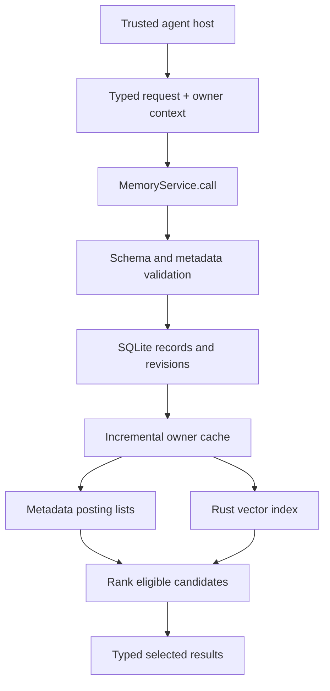

# MemoryCore 0.4 architecture

The typed memory service uses a local SQLite database, per-owner metadata posting lists,
and a generic Rust exact vector index. Topic/tool vocabulary belongs to registered data,
not Python enums or packed Rust bitfields.

## Request and storage boundaries

`operation` discriminates requests; `kind` discriminates memory variants; `op` discriminates
filter nodes. Reused TypeAdapters validate boundaries. Hydration validates each changed
record once; a warm query does not reconstruct 50,000 Pydantic models.

The memory kinds are preference, decision, observation, and procedure. They have distinct
required fields plus a common scope, lifecycle, provenance, revision, and schema version.
These stable protocol concepts are intentionally defined in code. Domain vocabulary is not.

## Filtering

Metadata is registered per owner. Types and aliases are immutable once registered; a changed
type requires a new versioned field and deliberate data migration. Aliases cannot shadow
canonical fields or other aliases. Both writes and filters use canonical names.

| Operator | Field type | Empty/missing behavior |
|---|---|---|
| `eq` | keyword, number, boolean | Missing never matches |
| `in` | keyword, number, boolean | Empty list matches nothing |
| `contains_any` | keywords | Empty list matches nothing |
| `contains_all` | keywords | Empty list matches present arrays, including empty arrays |
| `range` | number | Inclusive bounds; missing never matches |
| `exists` | any registered field | Matches a present field, including an empty array |
| `all` | filter group | Empty group matches the eligible universe |
| `any` | filter group | Empty group matches nothing |

Unknown fields are validated even in branches which could otherwise short-circuit.
Boolean and numeric values use distinct index keys. Numeric range lookup uses a lazily
sorted value index. Filter depth is limited to eight; each group/value list is bounded.

The engine adds read-only `kind` and `status` values to its index; callers cannot spoof them
through metadata. Recall defaults to active records. Supply `statuses` explicitly when
inspecting disputed/superseded history; an empty statuses list returns nothing.

Owner is a trusted call argument, not an agent request field. A project request includes
that project's records and global user records; it excludes other projects. A request
without a project includes global user records only. A metadata filter cannot widen scope.

## Ranking

The Rust index stores normalized float32 vectors, keyed by memory ID, with no topic/tool
knowledge. It scores only the IDs selected by metadata and scope. It rejects zero,
non-finite, and dimensionally incompatible vectors. Python validates before persistence.

Semantic and lexical candidate generation run independently. Their union is ranked by
weighted nonnegative cosine similarity and query-token coverage. `RetrievalPolicy` exposes
weights, candidate budgets, and a minimum score. The defaults are 0.7 semantic and 0.3 lexical.
Ties break by ID. This is token-overlap ranking, not BM25 or an LLM reranker.

The legacy conversation engine now searches all of a user's vectors; a keyword flood no
longer removes semantically relevant records before scoring. The typed service provides
the richer metadata and combined ranking path.

There is no ANN or k-means dependency. Measure exact-search latency and recall first;
`benchmarks/memory_scale.py` measures end-to-end mechanics. `evaluate_retrieval` measures
recall@k, precision@k, reciprocal rank, and latency against labeled query cases. It does
not automatically promote a candidate configuration.

## Preferences

Preference applicability is AND across fields and OR across values within a field.
Missing task attributes do not match a constrained preference. No semantic similarity
cutoff or top-k is involved in preference resolution.

Explicit rules are preferred over inferred observations for a key. Among those, project
rules override global rules. Multiple differing values at the same precedence, or disputed
records, produce a conflict rather than a guessed winner. Matching equivalent rules retain
their individual provenance. Superseded records are excluded. `complete` means the full
applicable set was considered, not that all conflicts were resolved or that the AI obeyed it.

## Transactions and caches

SQLite `BEGIN IMMEDIATE` serializes reconciliation commits before version checks. A callback
runs outside the transaction on a snapshot; commit checks the owner generation and target
revision again. Changes to the record, evidence, lifecycle, and audit trail commit together.
A database failure leaves the prior searchable state intact.

Each owner has a generation counter. A cache loads rows newer than its last generation,
including changes from other service instances. Reads currently acquire the same SQLite
transaction discipline as writes, favoring consistency over multi-process read throughput.
Embedding identity includes model ID, revision, and dimensions. A model change cannot
silently mix incompatible vectors.

`MemoryService` contains orchestration; `catalog.py`, `preferences.py`, `reconciliation.py`,
`dream.py`, and `migration.py` implement the individual workflows. Internal indexes use
ordinary Python containers and Rust structs; Pydantic remains at boundaries.
