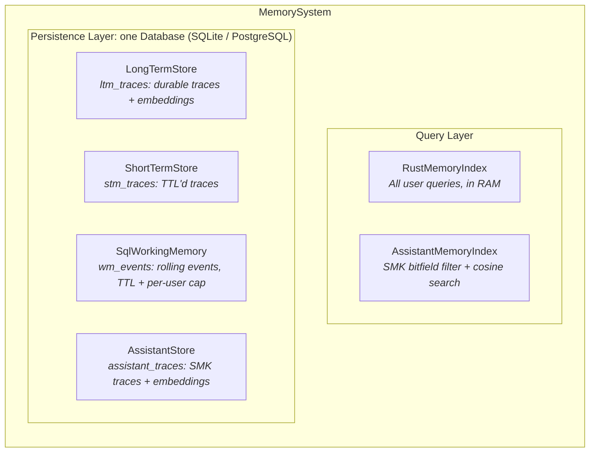
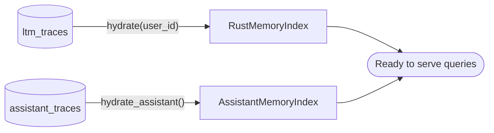
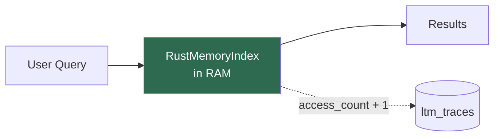
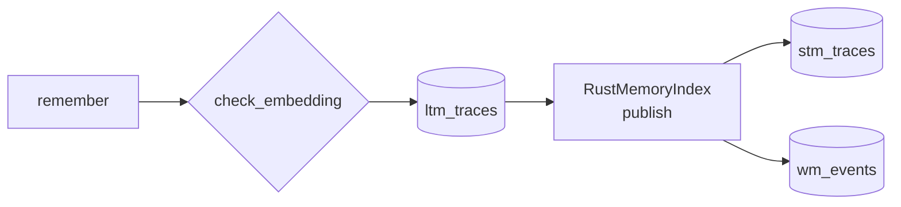
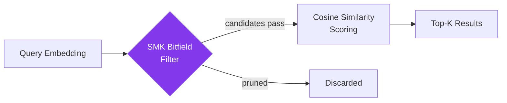

# Architecture

## Overview

MemoryCore separates **query** from **storage**. All runtime queries hit the Rust-backed
in-memory indexes (1-10ms). One SQL database (a local SQLite file by default; any
SQLAlchemy URL works) is the source of truth, used for persistence and startup hydration.



## Data flow

### Startup



`Database.create_schema()` creates missing tables and applies additive column
migrations idempotently (`build_memory_system` does this by default).
`MemorySystem.hydrate(user_id)` replays each persisted trace with a stored embedding into
the index; `hydrate_assistant()` does the same for every assistant trace. Both are
upserts, so repeating them is safe.

### Query (fast path)



`recall` searches the in-RAM index, marks returned candidates accessed (in the index and
in `ltm_traces`, so counts survive restarts), and attaches the STM/WM sidebands.

### Write



Validate, persist, publish. The embedding is checked against the index before anything
is written, so input it would reject never reaches the database (where it would break
every later hydrate). The trace is published to the index only once durable, so a
concurrent recall can never see (or count an access on) an unpersisted trace; if the
publish still fails, the new LTM row is deleted. A failed LTM write leaves the index
untouched. `remember_assistant` follows the same order (`AssistantMemoryIndex.prepare`
validates dimension, SMK fields, and id collisions) under a per-system lock, so
concurrent upserts of one uid cannot leave the index and store disagreeing, and a failed
store write keeps the previous version searchable. LTM is the source of truth; the index
mirrors it.

### Forget

`forget(trace_uid)` removes the trace from the index (its memory is freed, not
tombstoned), deletes it from `ltm_traces` and `stm_traces` (even when STM is disabled
on this system, since another process may have written it), and deletes every
`wm_events` row linked to it. The migration that added `wm_events.trace_uid` backfills
links for events written before it. `forget_assistant(trace_uid)` does the same for the SMK
index and `assistant_traces`.

### SMK query pipeline



## Components

### Database

One engine + session factory + schema bootstrap, shared by every store.

```python
from memory_core import Database

db = Database(sqlite_path="~/data/memory.db")      # local file; parent dirs created
db = Database(sqlite_path=":memory:")              # in-process, discarded on exit
db = Database(url="postgresql+psycopg://...")      # anything SQLAlchemy speaks
db.create_schema()                                 # idempotent
```

`sqlite_path` (or `MEMORY_DB_SQLITE_PATH`) wins over `url` (or `MEMORY_DB_URL`); an
explicit `url` override clears an env-provided `sqlite_path`.

SQLite specifics:

- **File databases**: `~` is expanded and the parent directory created; connections use
  `check_same_thread=False` (store calls run in worker threads), WAL journal mode
  (concurrent reader/writer turns don't block each other), and a 30 s busy timeout (two
  processes on one file wait out each other's write locks).
- **In-memory databases** (`:memory:`, `sqlite://`, `mode=memory`): one shared connection
  (`StaticPool`) with sessions serialized by a lock. SQLAlchemy's default pool would hand
  each worker thread its own empty database.

All datetimes are stored timezone-aware UTC, and expiry comparisons always use
Python-supplied bound parameters (never `func.now()`) so SQLite's string-typed datetime
comparisons stay consistent. Stores use `Database.session_scope()`, which rolls back on
error and always closes.

### RustMemoryIndex

The primary query engine. Wraps `PyMemoryEngine` from the Rust extension
(`memory_core._native`).

- Embeddings live as native `f32` vectors in Rust heap memory, stored densely; removal
  uses `swap_remove`, so deleted traces free their memory immediately.
- Candidates are seeded from per-user tag/keyword posting lists, with a fallback to all
  of the user's traces when fewer seeds than `limit` match. Updating a trace re-posts it,
  so an edited summary stops matching its old keywords.
- Score = `semantic * cosine + importance * importance + recency * 0.5^(age/half_life)
  + access * a/(1+a)` with `a = ln(1 + access_count)`. Defaults are 0.7 / 0.3 / 0 / 0
  (configure via `ScoringWeights`). Ties break newer-first, then by trace uid.
- The engine sits behind an `RwLock` and releases the GIL for every operation, so worker
  threads search in parallel and never stall the interpreter while waiting on the lock.

### LongTermStore

Durable traces + embeddings in `ltm_traces`. Upserts use `Session.merge`
(dialect-portable: the same code runs on SQLite and PostgreSQL).

```python
ltm.fetch_traces_for_user(user_id)  # [(MemoryTrace, embedding | None), ...]: hydration
ltm.increment_access(trace_uids)    # access_count + 1 per trace
ltm.delete_trace(trace_uid)         # permanent removal
```

### SqlWorkingMemory

Rolling per-user session events in `wm_events` (the semantics the previous Redis list
had: TTL decay, newest last), with a per-user row cap so a chatty session can't grow the
table without bound. Expired rows are pruned on every write for that user, and
`purge_expired()` sweeps every user. An event whose payload carries a string `trace_uid`
is linked to that trace and removed by `delete_for_trace` (called by `forget`).

```python
wm = SqlWorkingMemory(db, ttl_seconds=3600, max_events=500)
wm.add_event(user_id="alice", payload={"kind": "message", "text": "hello"})
events = wm.get_recent(user_id="alice", limit=20)
```

### ShortTermStore

TTL'd traces in `stm_traces` for recency recall; disabled by default
(`enable_stm=False`). `purge_expired()` deletes dead rows; `delete_trace()` supports
`forget`.

### AssistantMemoryIndex (SMK) and AssistantStore

A second index for assistant-level learning traces, using a packed 64-bit Structured
Memory Key for bitfield filtering before cosine similarity. Internal ids derive from
`blake2b(trace_uid)`: deterministic across processes, so ids survive restarts. Ingest is
an upsert keyed by trace uid and sets `trace.smk_raw` from the key Rust packed (one
source of truth for the bit layout). Removal frees the slot.

`AssistantStore` persists each trace (full model as JSON, plus `smk_raw` and the
embedding) in `assistant_traces`; `hydrate_assistant()` rebuilds the index from it.

SMK bit layout:

```
bits  0-7:   topic       (u8, 1..=255; 0 is reserved)
bits  8-10:  kind        (MemoryKind)
bits 11-26:  tool_mask   (16-bit ToolFlag mask)
bits 27-28:  difficulty  (Level2Bits)
bits 29-30:  generality  (Level2Bits)
bits 31-32:  importance  (Level2Bits)
```

Topic and tool meanings are defined only in Python (`TopicBucket`, `ToolFlag`). Rust
validates the ranges (topic non-zero, kind 0..=4, levels 0..=3) and raises `ValueError`
on anything else, so a new topic needs no Rust change.

### MemorySystem

The async orchestrator.

```python
from memory_core import build_memory_system

system = build_memory_system(sqlite_path="memory.db")        # SQLite + schema
await system.hydrate("alice")                                # LTM -> index
trace = await system.remember(user_id="alice", summary=..., importance=..., tags=[...],
                              embedding=[...])               # or configure an Embedder
result = await system.recall(user_id="alice", query_text=..., limit=10)   # RecallResult
await system.forget(trace.trace_uid)
await system.record_event(user_id="alice", payload={"kind": "turn", ...})
await system.purge_expired()                                 # PurgeResult

# assistant memory (enable_assistant_index=True, assistant_index_dim=N)
await system.hydrate_assistant()
await system.remember_assistant(trace=..., embedding=[...])
hits = await system.recall_assistant(k=5, query_embedding=[...], topic=...)
await system.forget_assistant(trace_uid)
```

`RecallResult` carries `ltm_candidates` (index hits, with `importance` and
`access_count`), `wm_events`, and `stm_traces`.

With an `Embedder` (any object with `async def embed(texts) -> vectors`), `remember`,
`recall`, `remember_assistant`, and `recall_assistant` all accept raw text and compute
embeddings internally.

## Per-user assistant pattern

Each user can get an isolated `MemorySystem` (own `RustMemoryIndex`) over one shared
`Database`: isolation at query time, one file on disk. See
`examples/per_user_assistant.py`. A single shared index also isolates users correctly
(candidates are drawn from per-user posting lists).

## Configuration

| Prefix | Component | Key variables |
|---|---|---|
| `MEMORY_DB_` | Database | `SQLITE_PATH` (wins), `URL` (default `sqlite:///memory_core.db`) |
| `MEMORY_CORE_` | MemoryCoreSettings | `WM_TTL_SECONDS`, `WM_MAX_EVENTS`, `STM_TTL_SECONDS`, `ENABLE_STM`, `ENABLE_ASSISTANT_INDEX`, `ASSISTANT_INDEX_DIM`, `SCORING__<FIELD>` |

Every setting has a working default. Programmatic `overrides` beat the environment and
are validated: unknown keys and out-of-range values raise.
