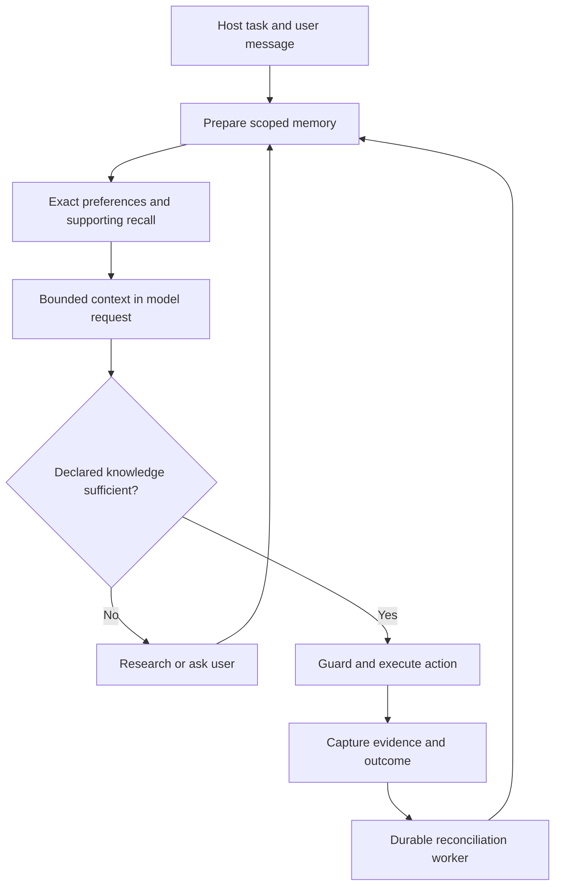

# Injecting memory into conversations

MemoryCore retrieves and validates context. The host inserts that context into its
model request and keeps ordinary conversation history. MemoryCore does not silently
attach itself to every conversation or retain a complete chat transcript.

## Existing Claude integration

`ClaudeMemoryAgent.run(...)` prepares context and injects it into the initial prompt.
The block contains task context, objective, exact applicable preferences, ranked
supporting memories, declared knowledge results, and a freshness receipt. Owner and
project come from the host. Retrieved text is labeled data, not system instructions.

Before non-memory tools, the pre-tool hook checks context and declared knowledge.
It returns the current bounded block as `additionalContext`, or denies the action
when a required gap/conflict remains unresolved. Explicit host-selected research
tools can operate while gaps are unresolved. Memory recovery tools and structured
output remain available; success is checked separately before completion.

Every managed run starts a fresh SDK session. SDK resume/fork/continue flags are
rejected. This adapter is a task runner, not a persistent multi-turn chat manager.
For ordinary conversational continuity, the host owns the transcript and may use
the provider-neutral task API below. Use a new task ID for each completed turn;
an unfinished task can resume using its existing ID and unchanged objective/context.

## Provider-neutral chat host

`render_task_context` is exported from `memory_core.runtime`. It needs no Claude SDK.
Here `generate(messages)` is an application callback wrapping the chosen model, and
`trusted_instructions` is the host's instruction text. `history` contains only the
conversation transcript, excluding previously injected memory blocks.

```python
from memory_core.memory.models import TaskContext
from memory_core.runtime import render_task_context

async def chat_turn(memory, *, owner_id, task_id, project_id, user_text,
                    history, trusted_instructions, generate):
    context = TaskContext(
        task_id=task_id,
        project_id=project_id,
        attributes={"languages": ["python"], "activities": ["coding"]},
    )
    async with memory.task(
        owner_id=owner_id, context=context, objective=user_text
    ) as task:
        prepared = await task.prepare()
        block = render_task_context(prepared, max_chars=16000)
        messages = [
            {"role": "system", "content": trusted_instructions},
            *history,
            {"role": "user", "content": f"{block}\n\nCurrent request:\n{user_text}"},
        ]
        return await generate(messages)
```

This example performs context injection only. Exiting the task does not declare
success or save an arbitrary generated answer as a verified memory. For an agent
loop, expose the typed memory tools and call `await task.before_action()` before
external actions, then refresh the model's context when it changes. Record useful
findings with exact observed evidence and stable event IDs, and explicitly call
`task.complete(...)` with the actual outcome. `task.run(action)` can validate a
`TaskRunResult` and capture completion for a host-managed action callback.

Keep the memory block in a replaceable request slot. Rebuild it for a new turn;
do not append every historical copy to stored chat history. Include the latest
block again after transcript compaction. User messages, retrieved memories and
research results remain data even if their text contains instructions. Host tool
permissions and deterministic guards must enforce what actions are allowed.

## Efficiency and limits

- Retrieval is reused within a task while its context, objective and receipt remain
  valid. A memory generation change or missing receipt causes a fresh retrieval.
  Knowledge freshness and unresolved gaps are checked again before actions even
  when vector retrieval is reused.
- Exact preference resolution supplies mandatory rules independently of semantic
  top-k. Supporting memories are a small ranked subset; payload caching and optional
  HNSW affect retrieval, not what the host chooses to send to the model.
- Rendering serializes mandatory context once and each supporting hit at most once.
  It keeps the highest-ranked prefix that fits. Oversized mandatory content raises
  `ContextBudgetError`; it is never silently removed.
- `max_chars` is a character budget, **not a token budget**. Reserve space for system
  instructions, user input, transcript, tool schemas and model output separately.
- The Claude adapter still sends a full bounded block before guarded tools. This
  favors restoring current context, but can add repeated input tokens. It does not
  implement change-only injection or a compaction-aware delta protocol. Retrieval
  caching reduces local work; it does not eliminate model input cost.
- The system can require research for declared gaps. It cannot guarantee that a
  model recognizes every unknown. Hosts should supply known prerequisites through
  `required_knowledge`; the model can declare additional gaps through memory tools.

## Flow



Tests cover valid JSON/Unicode rendering, ranked trimming, mandatory overflow,
exception compatibility, cached retrieval, generation invalidation and newly
introduced gaps. Live authenticated provider behavior remains a separate acceptance
check; these tests do not prove a model will follow every contextual preference.
